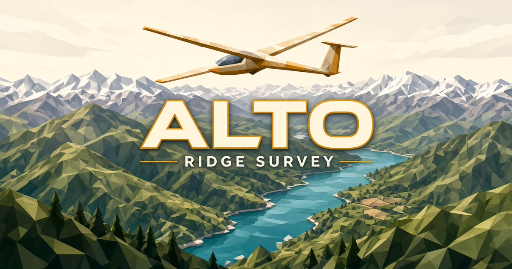

# Alto

A low-poly ridge survey you can fly. The craft holds altitude, so you point the nose and thrust. Ridges are solid — you scrape, you don't sink.

[](public/og.jpg)

## Fly

| Input | What it does |
| --- | --- |
| Mouse / drag | Look. Click the view to capture the pointer. |
| W / S | Thrust forward / ease off |
| A / D | Rudder. A turns left, D turns right. |
| Shift | Boost while thrusting |
| Space | Lift |
| F | Wireframe |
| N | Day / night |
| M | Mute |
| Esc | Pause |

On a phone, drag the sky to look and hold the on-screen buttons. Day, night, wire, and mute are remembered in the browser.

## Run

```bash
npm install
npm run dev
```

The dev server listens on port **8080**.

| Script | |
| --- | --- |
| `npm run dev` | Dev server |
| `npm run build` | Production build |
| `npm run typecheck` | TypeScript |
| `npm run test` | Unit tests |

## Stack

React 19, TanStack Start, Three.js, Zustand, Tailwind CSS v4. The world is a deterministic heightfield in [`src/game/terrain.ts`](src/game/terrain.ts). Flight, the chase camera, and the craft live in [`src/game/FlightCanvas.tsx`](src/game/FlightCanvas.tsx). There are no accounts — settings stay in `localStorage`.
